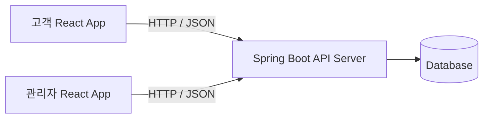
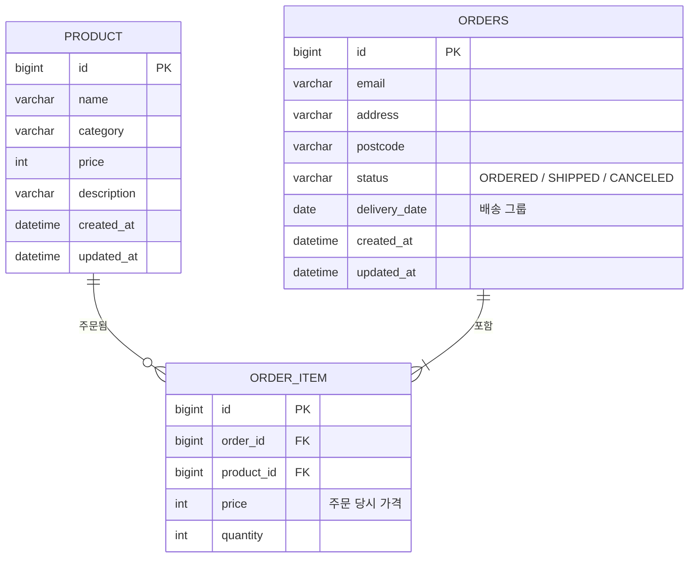

# ☕ Grids & Circles — 커피 원두 주문 관리 서비스

> Spring Boot 기반 CRUD API와 React 클라이언트로 구현하는 카페 메뉴·주문 관리 서비스
> 데브코스 1차 팀 프로젝트 (2026.11.26 ~ 2026.12.03)

---

## 📌 목차
1. [프로젝트 소개](#-프로젝트-소개)
2. [핵심 비즈니스 규칙](#-핵심-비즈니스-규칙)
3. [주요 기능](#-주요-기능)
4. [기술 스택](#-기술-스택)
5. [시스템 구성](#-시스템-구성)
6. [ERD](#-erd)
7. [API 명세](#-api-명세)
8. [예외 처리 정책](#-예외-처리-정책)
9. [패키지 구조](#-패키지-구조)
10. [팀 구성 및 역할](#-팀-구성-및-역할)
11. [협업 규칙](#-협업-규칙)
12. [일정](#-일정)
13. [심화 과제](#-심화-과제)

---

## 📖 프로젝트 소개

**'Grids & Circles'**는 작은 로컬 카페입니다. 고객은 온라인 웹사이트에서 커피 원두 패키지를 주문하고,
카페는 **전날 오후 2시부터 당일 오후 2시까지의 주문을 모아 하루 한 번** 배송합니다.

이 프로젝트의 목표는 다음과 같습니다.

- RESTful한 **CRUD API**를 직접 설계하고 구현하며 백엔드의 기본 구조를 익힌다.
- **Controller - Service - Repository** 계층을 분리하고 예외 처리를 체계화한다.
- ERD를 설계하고 실제 DB와 연동한다.
- 역할 분담, 브랜치 전략, 코드 리뷰를 통해 **팀 협업**을 경험한다.

---

## ⏰ 핵심 비즈니스 규칙

### 1. 오후 2시 마감 (배송 그룹 분리)
| 주문 시각 | 배송 그룹 |
|---|---|
| 전날 14:00:00 ~ 당일 13:59:59 | **당일** 배송 |
| 당일 14:00:00 이후 | **다음 날** 배송 |

> 고객 안내 문구: "당일 오후 2시 이후의 주문 건은 다음 날 배송이 시작됩니다."

### 2. 이메일 기준 주문 병합
- 회원가입 없이 **이메일 주소로 고객을 구분**합니다.
- 같은 이메일로 **같은 배송 그룹 안에서** 여러 번 주문하면 **하나의 주문으로 합쳐** 배송합니다.

### 설계 포인트
- 배송 그룹 계산은 `DeliveryPolicy` 클래스로 분리했습니다. DB에 의존하지 않는 순수 자바 로직이라 단위 테스트로 경계값을 검증할 수 있습니다.

---

## ✨ 주요 기능

### 👤 고객
- 원두 상품 목록 조회
- 장바구니에 담고 주문 (이메일, 주소, 우편번호 입력)
- 이메일로 내 주문 조회
- 배송 전 주문 수정·취소

### 🛠️ 관리자
- 상품 등록·조회·수정·삭제 (CRUD)
- 배송 그룹별 주문 목록 조회
- 주문 배송 상태 변경

---

## 🧰 기술 스택

| 구분 | 기술 |
|---|---|
| **Backend** | Java 17, Spring Boot 3.x, Spring Data JPA, Validation |
| **Database** | MySQL (개발·테스트: H2) |
| **Frontend** | React, React Router, Axios |
| **Test** | JUnit5, Mockito, Postman |
| **Docs** | Swagger (springdoc-openapi), Notion |
| **Collaboration** | GitHub, Notion (WBS·칸반), Slack |
| **Deploy (심화)** | Railway (Backend·DB), Vercel (Frontend) |

> 기술 스택은 1일차 설계 회의에서 최종 확정합니다.

---

## 🏗️ 시스템 구성



### 요청 처리 흐름
```
Client 요청
  → Controller   : 요청 DTO 검증(@Valid), 응답 변환
  → Service      : 비즈니스 로직 (2시 마감, 주문 병합, 상태 검증)
  → Repository   : JPA를 통한 DB 접근
  → DB
  ← 공통 응답 형식으로 반환 / 예외 발생 시 GlobalExceptionHandler가 에러 응답 반환
```

---

## 🗂️ ERD



### 설계 의도
- **`ORDER_ITEM` 분리:** 상품과 주문은 N:M 관계이므로 중간 테이블로 풀어 1:N 두 개로 구성했습니다.
- **가격 스냅샷:** `ORDER_ITEM.price`에 주문 당시 가격을 저장합니다. 이후 상품 가격이 바뀌어도 과거 주문 금액은 그대로 유지됩니다.
- **`delivery_date` 저장:** 배송 그룹을 컬럼으로 저장해 그룹별 조회와 이메일 병합 시 조회 조건을 단순하게 만들었습니다.

---

## 📡 API 명세

### 상품 (Product)
| 기능 | Method | URL | 사용자 |
|---|---|---|---|
| 상품 등록 | `POST` | `/api/products` | 관리자 |
| 상품 목록 조회 | `GET` | `/api/products` | 고객·관리자 |
| 상품 단건 조회 | `GET` | `/api/products/{id}` | 고객·관리자 |
| 상품 수정 | `PUT` | `/api/products/{id}` | 관리자 |
| 상품 삭제 | `DELETE` | `/api/products/{id}` | 관리자 |

### 주문 (Order)
| 기능 | Method | URL | 사용자 |
|---|---|---|---|
| 주문 생성 (2시 마감·병합 적용) | `POST` | `/api/orders` | 고객 |
| 내 주문 조회 | `GET` | `/api/orders?email={email}` | 고객 |
| 주문 수정 (배송 전만) | `PUT` | `/api/orders/{id}` | 고객 |
| 주문 취소 (배송 전만) | `DELETE` | `/api/orders/{id}` | 고객 |
| 배송 그룹별 주문 목록 | `GET` | `/api/admin/orders?deliveryDate={date}` | 관리자 |
| 배송 상태 변경 | `PUT` | `/api/admin/orders/{id}/status` | 관리자 |

### 요청·응답 예시 — 주문 생성
```http
POST /api/orders
Content-Type: application/json

{
  "email": "customer@example.com",
  "address": "서울시 강남구 ...",
  "postcode": "06236",
  "items": [
    { "productId": 1, "quantity": 2 },
    { "productId": 3, "quantity": 1 }
  ]
}
```
```json
{
  "orderId": 12,
  "email": "customer@example.com",
  "deliveryDate": "2026-11-27",
  "status": "ORDERED",
  "totalPrice": 15000,
  "items": [
    { "productId": 1, "name": "원두 상품 1", "price": 5000, "quantity": 2 },
    { "productId": 3, "name": "원두 상품 3", "price": 5000, "quantity": 1 }
  ]
}
```

> 상세 명세는 Swagger UI(`/swagger-ui/index.html`)와 Notion API 명세서에서 확인할 수 있습니다.

---

## 🚨 예외 처리 정책

`@RestControllerAdvice` 기반 `GlobalExceptionHandler`에서 예외를 일괄 처리합니다.

| 상황 | HTTP 상태 | 예시 |
|---|---|---|
| 입력값 검증 실패 | `400 Bad Request` | 이메일 형식 오류, 수량 0 이하, 가격 음수 |
| 존재하지 않는 리소스 | `404 Not Found` | 없는 상품·주문 id로 조회·수정·삭제 |
| 상태 충돌 | `409 Conflict` | 이미 배송된 주문의 수정·취소 |
| 서버 내부 오류 | `500 Internal Server Error` | 예상하지 못한 예외 |

### 에러 응답 형식
```json
{
  "status": 404,
  "code": "PRODUCT_NOT_FOUND",
  "message": "존재하지 않는 상품입니다. id=99"
}
```

---

## 📁 패키지 구조

```
backend/
└── src/main/java/.../
    ├── global/
    │   ├── common/          # 공통 응답 형식
    │   ├── exception/       # GlobalExceptionHandler, ErrorCode, 커스텀 예외
    │   └── config/          # Swagger, CORS 설정
    ├── product/
    │   ├── controller/
    │   ├── service/
    │   ├── repository/
    │   ├── domain/          # Product Entity
    │   └── dto/
    └── order/
        ├── controller/
        ├── service/
        ├── repository/
        ├── domain/          # Order, OrderItem, OrderStatus, DeliveryPolicy
        └── dto/

frontend/
└── src/
    ├── api/                 # axios 인스턴스, API 함수
    ├── pages/
    │   ├── customer/        # 상품 목록·주문, 내 주문 조회
    │   └── admin/           # 상품 관리, 주문 관리
    └── components/
```

---

## 👥 팀 구성 및 역할

| 담당 | 백엔드 | 프론트엔드 | 기타 |
|---|---|---|---|
| **A** | Spring 초기 세팅, 공통 예외 처리, Swagger, 상품 CRUD API | 고객 상품 목록, 관리자 상품 관리 화면 | ERD·API 명세 초안 정리, Postman 워크스페이스 세팅 |
| **B** | 주문 생성 API, 이메일 병합 로직 | 장바구니·주문 폼 화면 | Repo·컨벤션 세팅, Postman 통합 테스트, 회의록, 발표자 |
| **C** | 고객 주문 조회·수정·취소 API | React 초기 세팅, 고객 주문 조회 화면 | PM(WBS·칸반·스크럼), PPT 총괄·구성 |
| **D** | `DeliveryPolicy`(2시 마감), 관리자 주문 목록·상태 변경 API | 관리자 주문 관리 화면 | 데이터 흐름도, API 명세·ERD 최신화, 브랜치 정리·README, PPT 설계 장표·시연 시나리오 |

> 필수 작업 예상 시간: A 18h · B 17.5h · C 18h · D 18.5h (공동 작업 제외)
> 심화 과제는 담당을 정하지 않고, 필수 작업을 먼저 끝낸 사람이 맡습니다.
> 팀원 이름과 GitHub 계정은 확정 후 업데이트합니다.

---

## 🤝 협업 규칙

### 브랜치 전략
```
main      ← 최종 배포·발표용 (직접 push 금지)
 └─ dev   ← 기능 통합 (직접 push 금지)
     ├─ feature/product-crud
     ├─ feature/order-create
     └─ fix/order-cancel-status
```
- 작업은 `dev`에서 `feature/*` 브랜치를 만들어 진행합니다.
- PR을 올리고 **팀원 1명 이상 승인** 후 `dev`에 merge합니다. 리뷰어는 A→B→C→D→A 순서로 돌아가며 맡습니다.
- 발표 전날 `dev`를 `main`으로 merge합니다.

### 커밋 컨벤션
| 타입 | 설명 | 예시 |
|---|---|---|
| `feat` | 새 기능 | `feat: 상품 등록 API 구현` |
| `fix` | 버그 수정 | `fix: 없는 상품 삭제 시 500 에러 수정` |
| `refactor` | 리팩터링 | `refactor: 주문 병합 로직 Service로 분리` |
| `test` | 테스트 | `test: 2시 마감 경계값 테스트 추가` |
| `docs` | 문서 | `docs: README API 명세 업데이트` |
| `chore` | 설정·빌드 | `chore: Swagger 의존성 추가` |

### 회의
- **데일리 스크럼:** 매일 오전, 컨디션·오늘 할 일·막힌 점 공유
- **WTL:** 주 1회 (11/30 월), 회의 후 요약을 Slack 팀 채널에 공유

---

## 📅 일정

| 날짜 | 단계 | 주요 작업 |
|---|---|---|
| 11/26 (목) | 기획·설계 | 역할 분담, ERD·API 명세 확정, Spring·React 초기 세팅 |
| 11/27 (금) | 개발 | 상품 CRUD, 주문 생성, 2시 마감 로직과 단위 테스트 |
| 11/30 (월) | 개발 | 이메일 병합, 주문 수정·취소, 관리자 주문 API, WTL |
| 12/01 (화) | 개발 | 고객·관리자 화면 연동, 병합 단위 테스트 |
| 12/02 (수) | 마무리 | 통합 테스트, 12:00 기능 동결, 배포, PPT 작성 |
| 12/03 (목) | 발표 | 리허설, **14:00 발표** |

---

## 🔥 심화 과제

> 기본 요구 사항을 모두 달성한 뒤 아래 과제 중 선택해 진행합니다.
> 모든 과제는 기본 요구 사항을 끝낸 뒤 시간 여유가 있을 때 진행합니다.
> 상태: ⬜ 미진행 → 🟨 진행 중 → ✅ 완료

### 1. 인프라 & 배포 (Deployment)
| 과제 | 내용 | 상태 |
|---|---|---|
| 클라우드 서비스를 활용한 배포 | Spring Boot 서버와 DB는 Railway에, 프론트엔드는 Vercel에 배포 (DB는 H2 사용 가능) | ⬜ 미진행 |
| 커스텀 도메인 연결 및 HTTPS 적용 | 배포한 서비스에 고유 도메인을 연결하고 SSL 인증서 적용 | ⬜ 미진행 |

### 2. 데이터 분석 & 조회 (Data & Query)
| 과제 | 내용 | 상태 |
|---|---|---|
| 관리자 통계 대시보드 | 일별·월별 매출 통계, 가장 많이 팔린 원두 Top 3 등 집계(Aggregation) 쿼리를 작성하고 관리자 페이지에 시각화 | ⬜ 미진행 |
| 주문 검색 및 페이지네이션 | 서버 사이드 페이징 적용, 상품명·주문일·주문 및 배송 상태 기반 검색 | ⬜ 미진행 |

### 3. 실시간 알림 시스템 (Real-time Notification)
| 과제 | 내용 | 상태 |
|---|---|---|
| 관리자 실시간 주문 알림 | 고객이 주문을 완료하면 관리자 페이지에 새로고침 없이 알림 팝업 표시 (SSE 또는 WebSocket) | ⬜ 미진행 |
| 외부 메신저 연동 및 메시지 큐 적용 | 주문 완료 이벤트를 Discord Webhook 등으로 발송. 주문 처리와 알림 발송 로직을 분리하고 메시지 큐(RabbitMQ, Kafka, Spring 내부 Event 등)로 비동기 처리 | ⬜ 미진행 |

### 4. 비즈니스 로직 검증 및 테스트 자동화 (Test Code)
| 과제 | 내용 | 상태 |
|---|---|---|
| 핵심 비즈니스 로직 단위 테스트 | "오후 2시 전후 주문 분리"와 "동일 이메일 기준 당일 주문 병합" 로직을 DB 없이 JUnit5·Mockito로 검증 | ⬜ 미진행 |
| 경계 조건 및 예외 상황 테스트 | 13:59:59 주문과 14:00:00 주문이 각각 올바른 배송 그룹으로 분류되는지 경계값 테스트 | ⬜ 미진행 |

---

## 🚀 실행 방법

> 초기 세팅 완료 후 작성합니다.

```bash
# Backend
cd backend
./gradlew bootRun

# Frontend
cd frontend
npm install
npm run dev
```
